# Portfolio Website

My personal portfolio — built with Next.js and Tailwind CSS, showcasing my experience in RPA/automation and Agentic AI, projects, certifications, and a live feed of my Medium articles.

- 🌐 **Live site:** https://kshitijdarwhekar.com
- 📝 **Blog:** https://medium.com/@kshitijdarwhekar

## Table of Contents

- [V1 → V2](#v1--v2)
- [Features](#features)
- [Technologies](#technologies)
- [Screenshots](#screenshots)
- [Getting Started](#getting-started)
- [Project Structure](#project-structure)
- [Deployment](#deployment)
- [Customization](#customization)
- [Contributing](#contributing)

## V1 → V2

The site went through a full redesign in 2026 — new visual direction, two new sections, and a content refresh to match my current focus (RPA/Agentic AI rather than the older frontend-heavy copy).

| V1 (before) | V2 (after) |
|---|---|
|  | 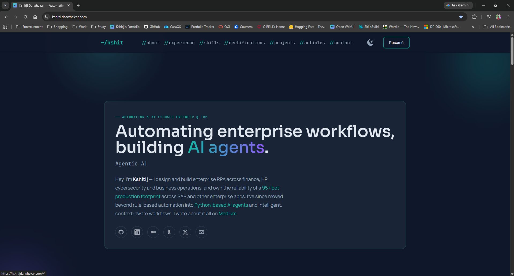 |

**What changed:**
- Dark-first "modern dark tech" visual system — gradients, glass-panel cards, a cursor-reactive glow, scroll-reveal and hover-lift motion
- New **Articles** section — pulls my latest Medium posts live via RSS, no manual updates needed
- New **Certifications** section — curated from my certs, linking out to Credly for verified badges
- Content rewritten to reflect my actual current work (RPA on Automation Anywhere 360, Agentic AI, Celonis — process mining experience, SAP) instead of stale copy
- Real bugs fixed along the way: broken mobile nav, a contact form that used to wipe the page on submit, shared hover state across all project cards, and more
- Broke the old single ~500-line component into proper Server/Client components

<details>
<summary>📸 See the full V1 gallery (dark + light mode)</summary>

### V1 — Dark Mode

- Landing Page

  

- About Section

  

- Skills Section

  

- Portfolio Section

  

- Contact Me

  

- Footer

  

### V1 — Light Theme

- Landing Page

  

- About Section

  

- Skills Section

  

- Portfolio Section

  

- Contact Me

  

- Footer

  

</details>

## Features

- Dark-first design (default) with a persistent light/dark toggle
- Hero, About, Experience (timeline), Skills, **Certifications**, Projects, **Articles** (live Medium feed), and Contact sections
- Fully responsive, with a working mobile nav
- Scroll-reveal and hover-lift micro-interactions, respecting `prefers-reduced-motion`
- Contact form via Formspree, with honeypot spam protection
- Auto-generated Open Graph / social-share preview image, always in sync with the live site
- Google Analytics + Vercel Analytics/Speed Insights

## Technologies

- **Next.js 14** (App Router) — Server and Client Components
- **Tailwind CSS** — utility-first styling
- **Formspree** — contact form backend
- **rss-parser** — live Medium article feed
- **next/og** — dynamic Open Graph image generation
- **Vercel** — hosting and analytics

## Screenshots

### V2 — Desktop

- Hero

  

- About

  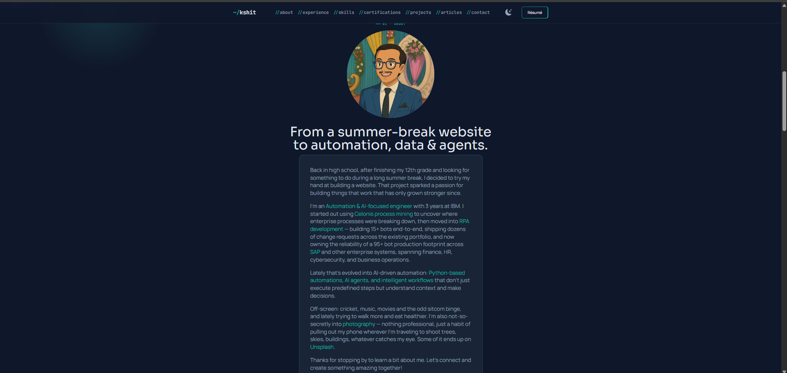

- Experience

  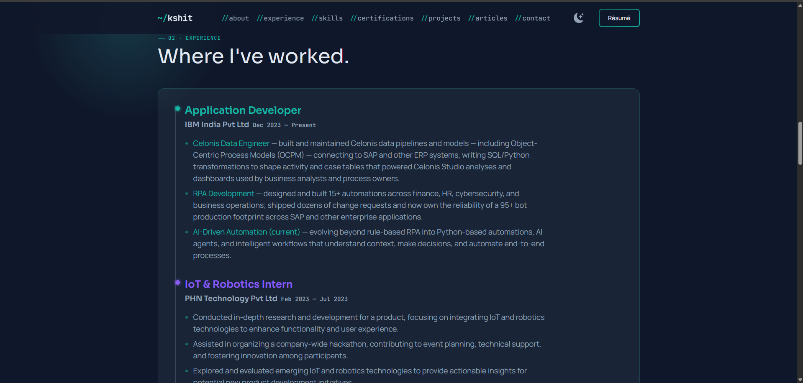

- Skills

  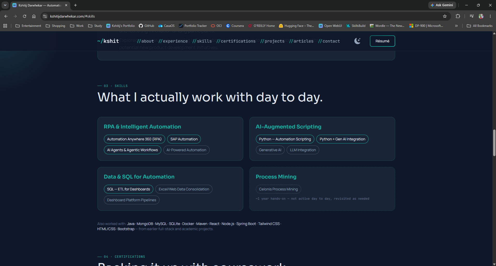

- Certifications

  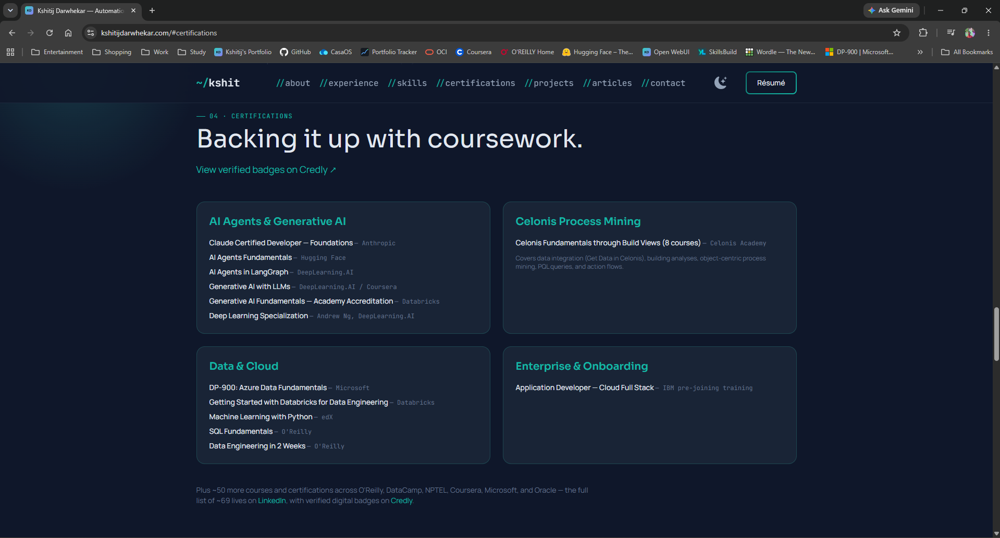

- Projects

  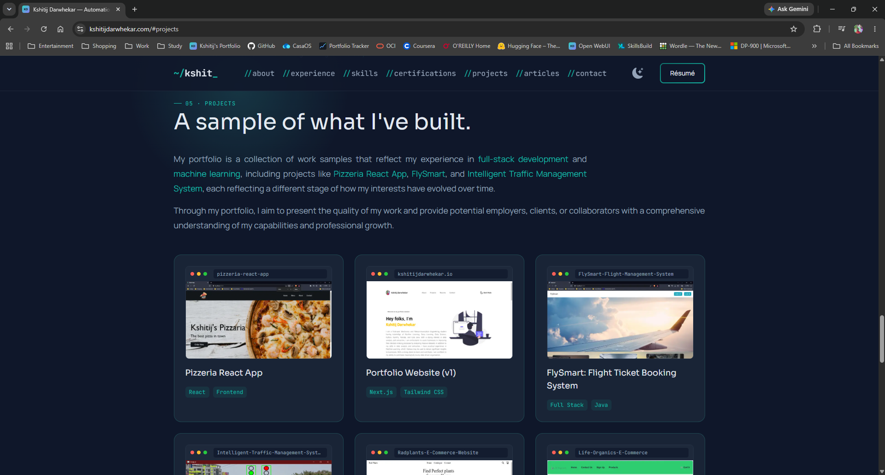

- Articles

  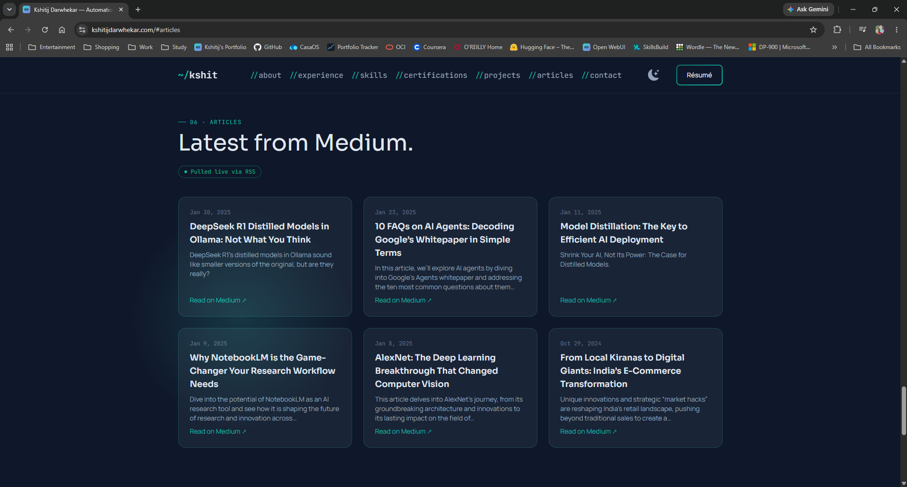

- Contact

  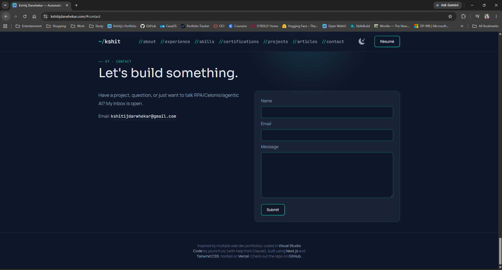

<details>
<summary>📱 See the V2 mobile gallery</summary>

| | |
|---|---|
| 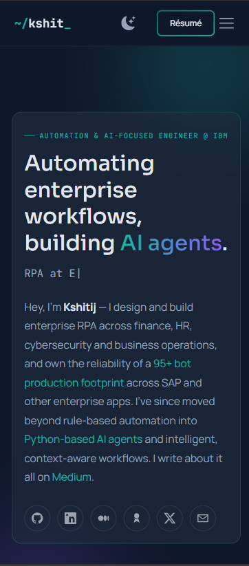 | 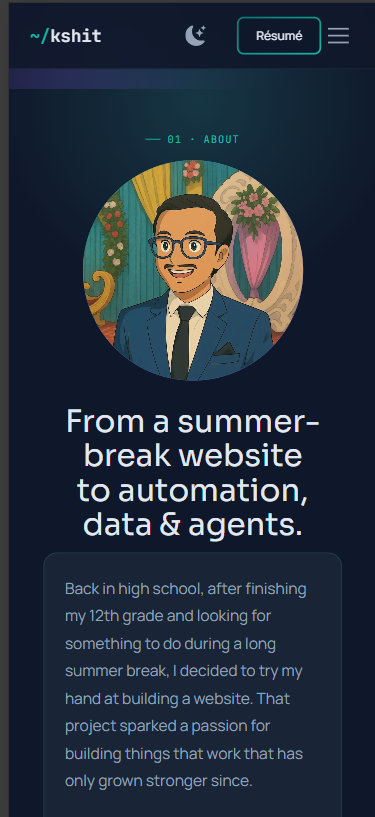 |
| 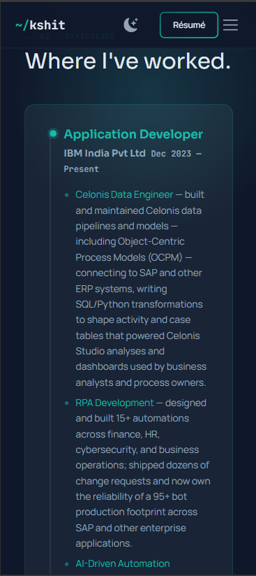 | 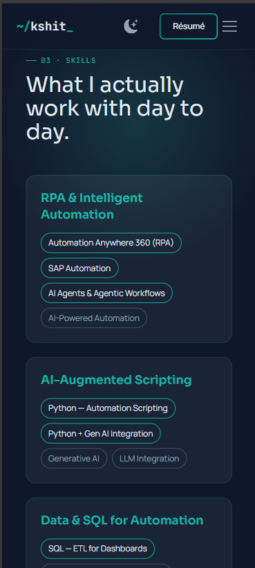 |
| 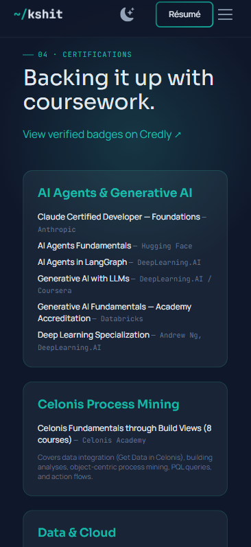 | 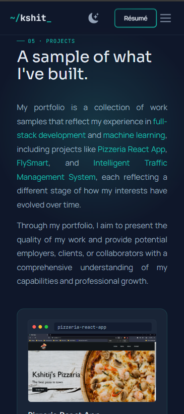 |
| 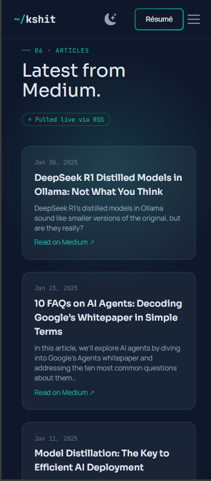 | 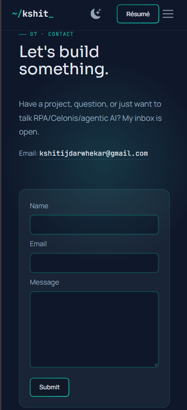 |

</details>

> Full V1 gallery is in the [collapsed section above](#v1--v2) for comparison.

## Getting Started

To run the portfolio website on your local machine:

1. Clone the repository:

```bash
git clone https://github.com/Kshitij-Darwhekar/Kshitij-Website.git
```

2. Navigate to the project directory:

```bash
cd portfolio-website
```

3. Install the dependencies:

```bash
npm install
```

4. Set up environment variables (see `.env.local` — you'll need a [Formspree](https://formspree.io/) form ID and a Google Analytics Measurement ID):

```bash
NEXT_PUBLIC_FORMSPREE_FORM_ID=
NEXT_PUBLIC_GA_ID=
```

5. Start the development server:

```bash
npm run dev
```

6. Open your browser and visit `http://localhost:3000` to view the website.

## Project Structure

```
src/
  app/            # Next.js routes, layout, metadata, OG image
  components/     # layout/ (nav, footer) and sections/ (hero, about, etc.)
  data/           # content as plain data (projects, skills, experience, etc.)
  hooks/          # useInView (scroll-reveal)
  lib/            # Medium RSS fetching/parsing
public/           # static assets served by the site (fonts, favicon, etc.)
docs/screenshots/ # README images only — not part of the deployed site
```

## Deployment

Deployed on [Vercel](https://vercel.com/docs), connected directly to this repo — pushes to `main` deploy to production automatically, and any other branch gets its own preview deployment.

Remember to set `NEXT_PUBLIC_FORMSPREE_FORM_ID` and `NEXT_PUBLIC_GA_ID` in your hosting platform's environment variables (a local `.env.local` only affects local development).

## Customization

- Update content under `src/data/` with your own information.
- Add or remove sections in `src/app/page.js`.
- Adjust design tokens and the `glass-panel`/`glass-card` styles in `src/app/globals.css`.
- Replace the favicon in `src/app/opengraph-image.js` (also used for the auto-generated social preview image) and `public/favicon.ico`.
- Point `src/lib/medium.js` at your own Medium RSS feed.
- Set your own [Formspree](https://formspree.io/) endpoint and Google Analytics ID.

## Contributing

Contributions are welcome! If you encounter any issues, have suggestions, or want to contribute new features, please open an issue or submit a pull request.
